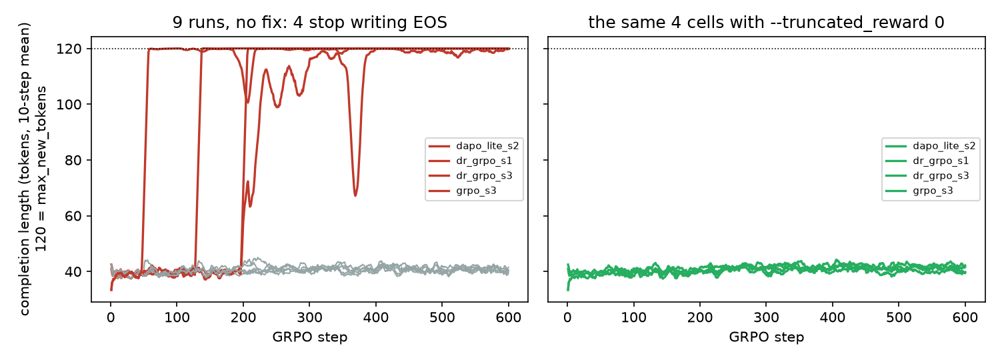
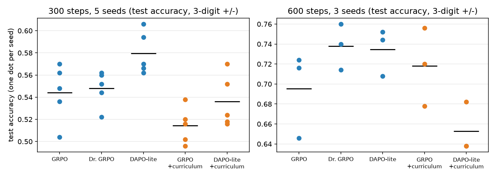

# 从零训一个 100M 的模型，再用 RL 教它做算术：哪些数字可信，哪些不

> 项目：[Whetstone](https://github.com/irroca/Whetstone)。从零写的 PyTorch 代码，预训练一个 99.5M 参数的中英双语模型，
> 再在可验证任务（算术、代码）上做 SFT、DPO、蒸馏和 GRPO。文中每个数字都能在仓库的 `records/` 里重算，出处写在每节末尾。
> 这篇文章讲的不是「我训出了一个多强的模型」（它不强），而是**做 RL 实验时，哪些现象会骗你**。

**这是一篇要认真读、读完要去查证的文章。** 它同时是项目的学习材料：

- 第 1 节讲全貌和**数据来源**（面试第一个问题）。第 2–8 节是发现，每节末尾有一个「📚 自己去查证」框，
  列出这一节涉及的概念、代码位置和能自己跑的检查。
- 附录 A 是概念速成（公式和直觉），附录 B 是阅读清单，**附录 C 是面试准备（问答、能说和不能说的话）**，附录 D 是动手验证清单和学习路线。
- 标记：✅ 有数据直接支撑；🟡 是我的解释或假设，没有被实验证明；📚 需要你自己查证或补背景。
  我引用的论文和一般性 ML 知识是凭记忆写的，**面试前请对照原文核对**，不要把我的转述当成权威。

## 先说结论

1. 在两位数加减法上，GRPO 把一个 SFT 过的 100M 模型的 test 准确率从 0.628 推到 0.948，格式率始终 1.000：被 RL 推高的是准确率本身。
   更小的 29M 模型上同一套代码，150 步里 accuracy 始终是 0.000，只学会了格式。区分这两件事靠的是**把 accuracy 和 format 分开记**。
2. 四种 GRPO 变体（GRPO、加 KL、Dr. GRPO、DAPO-lite）在一两位数的题上分不出高低，原因能点名：截断从不触发、回答长度几乎不变、
   梯度尺度被 Adam 吸收。换到更难的三位数题上，**变体之间的差距还是小于种子之间的差距**。
3. 三位数的种子网格里，9 个跑次有 4 个在训练中途**突然不再输出 EOS**，回答一直写到 token 上限。准确率曲线对此几乎是瞎的。
   一行修复（没有 EOS 的采样按错处理）之后种子噪声减半，5 个种子下 DAPO-lite 才第一次按种子分出来（0.580 对 0.544）。
4. 三个看起来合理、结果为负的实验：按解题率选题的课程学习（更差）、DPO 单独使用（没动）、从 RL 老师做 logit 蒸馏（没赢过 SFT）。
5. 代码环境（沙箱里跑单元测试当奖励）上，RL 整族整族地修好模板，不迁移到没见过的族，还会忘掉只在 SFT 里见过的族；
   把这些族按 40% 混回 RL 的 prompt 池，遗忘就消失了。

## 1. 全貌：这个项目是什么、数据哪来、哪些是继承的

先把「谁在什么时候做了什么」讲清楚，面试时这是最先被问到的。

### 1.1 流水线

```text
公开语料 ──prepare──▶ 过滤/去重/去污染 ──tokenize──▶ train.bin ──pretrain.py──▶ 基座 (99.5M)
                                                                              │
合成的算术/代码题 ──generate_data──▶ sft.jsonl ──sft.py──▶ SFT 策略 ◀──────────┘
                                                  │
                    ┌─────────────┬───────────────┼────────────────┐
                    ▼             ▼               ▼                ▼
                 grpo.py       dpo.py         distill.py      eval_env.py
              （在线采样 +    （偏好对）     （老师 → 学生）    （贪心评测，
               可验证奖励）                                       逐题记录）
```

### 1.2 数据：每个阶段的数据从哪来（这张表要背下来）

| 阶段 | 数据 | 怎么来的 | 谁决定的 |
|---|---|---|---|
| 预训练 | 99.1 亿 token：中文网页 20%（FineWeb2-HQ）、英文教育网页 32%（FineWeb-Edu）、Python 代码 22.9%（StarCoderData）、数学 16%（FineMath）、书籍 5.7%（Gutenberg）、合成教科书 3.4%（Cosmopedia v2） | `datatools.prepare` 从 HuggingFace 流式拉取 → 过滤 → 精确去重 → 与评测集去污染（13-gram）→ 划分 | 配比由 `configs/mixture_v2.json` 定，依据是 25.7M 代理模型上的消融（中文占比、词表大小）|
| SFT | 4000 条合成的算术题 + 解题过程（`datasets/arith_v2/sft.jsonl`）；代码环境是 26 个模板族的 Python 小函数 | 仓库里的代码按模板生成（`envs.generate_data --split sft`），解题过程是写死的模板文字，固定随机种子，任何机器可重新生成 | 自己设计的任务 |
| GRPO | 2 万道题的 prompt 池；**没有标准答案数据**，奖励由代码判分 | 同一个生成器；奖励 = 答案正确（1.0）+ 格式正确（0.2），代码环境是沙箱里跑隐藏用例 | 自己设计的环境（`envs/`）|
| DPO | 2000 对手工损坏的偏好对；2022 对 on-policy 偏好对 | 前者由生成器把正确答案改坏；后者由 `mine_pairs.py` 让策略自己采样，把对的和错的配成一对 | 自己设计 |
| 蒸馏 | 同一份 4000 条合成 SFT 数据；老师是我们自己的 RL 策略 | 学生是 42.5M 的消融模型 | 自己设计 |
| 评测 | dev / test 各 500 道合成题，**显式排除训练题** | 固定种子生成；外部基准（MATH-500、GSM8K、MMLU、HumanEval、MBPP、TAL-SCQ5K）只用来做预训练语料的去污染，不参与训练 | |

所以后训练**没有用任何公开的 SFT / 偏好 / RL 数据集**。这既是优点（答案唯一、可自动判分、评测集可以严格隔离、全部可重新生成），
也是这个项目最大的边界：它验证的是 RL 流程和现象，不是模型在真实数学或代码上的能力。简历和面试里请说成「预训练用公开语料，
后训练用自己合成的可验证任务」。

### 1.3 哪些是继承的，哪些是这一轮新做的

- **继承的是代码骨架，不是数据**：仓库最早是 2025-09 的一个小项目（模型、`chat.py`、基础训练脚本）。算术环境和第一版 GRPO
  在 2026-09-23 的 PR #4 里就有了，那时预训练数据还没开始找。
- **这一轮新做的**：语料方案和数据管线（选源、过滤、去重、去污染、memmap）、数据消融、正式预训练、`trainer.py` 共用训练循环和精确续训、
  SFT/DPO/KD/GRPO 的全部实验（数据、跑次、记录）、三位数任务、代码环境和沙箱、EOS 修复、课程实验、`records/` 记录体系。
- **项目是在 AI 编程助手的协作下完成的**（你提需求、做决定、租卡、审查和合并 PR，助手写大部分代码和文档）。面试里最稳妥的做法是直说，
  然后把重点放在你能解释的东西上：为什么这么设计、实验怎么验证、哪些结论站得住、哪些不能说。这篇文章的附录 C 就是为此准备的。

### 1.4 模型和训练规格

- 模型：99.5M 参数，`dim 768、12 层、12 个注意力头、3 个 KV 头（GQA）`，SwiGLU 前馈（隐层 2048）、RoPE（θ=1e6）、RMSNorm、
  输入输出嵌入共享，词表 32,768（BPE，**数字逐位切分**）。嵌入层占参数的 25.3%。
- 预训练：9.914B token 一个 epoch，每次更新约 52.4 万 token，共 18,919 次更新；AdamW（β 0.9/0.95，权重衰减 0.1 只作用于矩阵），
  学习率 6e-4 经 10% 线性预热后余弦衰减到 6e-5，bf16，1×H800 PCIe 8.29 小时，验证 loss 2.554（ppl 12.86）。
  按每个参数约 100 个 token 算，训练量约是常被引用的「计算最优」比例（约每参数 20 token，📚 请核对）的 5 倍——这是有意的过训练，小模型常见做法。
- 后训练：SFT 1 个 epoch、学习率 1e-4；GRPO 每步 32 个 prompt × 每个 8 条采样，学习率 2e-5（三位数任务），
  回答最长 120 个 token，温度 1.0。

基座本身几乎不会算术：4-shot 一位数加法 22%、两位数 2%，样本里能看到它在「抄上面例子的答案」。所以流程是 SFT 冷启动，再 GRPO。冷启动本身也有讲究（第 3 节）。

## 2. 奖励曲线会骗你

最早的 RL 实验在 29M 的模型上：reward 稳步上升，format rate 一路涨到 0.9 以上，看起来一切顺利。
但环境把「格式正确」和「答案正确」分开记了，还单独算了一个 `hacked_format`（格式对、答案错）。
结果是：**accuracy 在 150 步里每一步都是 0.000，`hack_rate` 与 `format_rate` 逐点相等**。策略只优化了它够得着的那一部分奖励。
如果只记一条标量奖励，这条曲线会被写成「训练有效」。

换成 100M 模型加 SFT 冷启动，同一套代码：12 个跑次（4 变体 × 3 种子，500 步）的 test 准确率从 0.628 升到 0.938–0.962，
平均回答长度几乎不变（36 个 token），两位数的题基本做对（加法 0.986、减法 0.976）。这次是 accuracy 本身在涨。

教训很朴素：**RL 实验里，奖励的每个分量都要单独记**；否则你分不清是模型学会了任务，还是学会了任务里最容易拿分的部分。


> **📚 自己去查证**
> - 概念：奖励塑形与奖励作弊（reward hacking）；为什么要把奖励拆成分量记录。
> - 代码：`envs/arithmetic.py` 的 `score`（accuracy 1.0 + format 0.2，`hacked_format` 是格式对答案错）；`grpo.py` 的 `grpo_metrics.jsonl` 里每步的 `accuracy`、`format_rate`、`hack_rate`。
> - 自己确认：`docs/experiments.md` 的「What both runs actually learned」一节有 29M 那批跑次的原始数字；`records/posttrain_v1/summarize.py` 重算 100M 的 12 个跑次。
> - 要能回答：如果当时只记了总奖励，这条曲线会说明什么？（看起来在稳步变好，但其实只有格式分在涨。）

## 3. 零方差：GRPO 的吸收态，以及冷启动的窄窗口

GRPO 的优势是组内相对的：一个组里所有样本奖励相同，优势就全是 0，这一组对梯度没有贡献。于是有两个现象：

**零奖励是吸收态。** 29M 的两个对照跑，唯一的区别是 `--kl_coeff 0.02`。不加 KL 的那个在第 50 步前后崩溃，之后奖励处处为 0，
每组方差为 0，`grad_norm` 恰好为 0，持续 100 步，熵从 3.75 掉到约 1.3，策略退化成重复一个 token。加了 KL 的熵稳在 2.0 左右，
格式率单调升到 0.915。这里 KL 的作用不是温和的正则，而是**不让这次训练死掉**。反过来，100M 的跑次不加 KL 也不会崩，
因为那个起点有混合组，没有崩溃可防。「要不要 KL」取决于起点有没有奖励方差。

**冷启动不是做了 SFT 就行。** 代码环境里量到了更极端的版本：
在全部 22 个族上 SFT 到 loss 0.0000，见过的族 1.000、没见过的 0.000，RL 没有东西可以改善；
只在 12 个族上 SFT，其余 10 个族是 0%，GRPO 探针里 `grad_norm` 恰好为 0；
每个其余族给 3 条示例，才有信号（采样准确率约 0.3）。SFT 之后的策略要恰好落在「有的会、有的不会」的区间里，RL 才有活干。

到了三位数的题，这件事变成日常：SFT 起点上 72% 的组是零方差，训练后期是 80–88%。绝大多数 rollout 的算力，花在了没有梯度的组上。
这也是后面想用课程学习去解决的问题。


> **📚 自己去查证**
> - 概念：GRPO 的组相对优势（附录 A.6）；KL 惩罚与参考模型；为什么优势归零就没有梯度。
> - 代码：`losses.py` 的 `grpo_advantages`、`zero_variance_groups`、`approx_kl`；`rollout.py` 的 `rollout_stats`（`silent_group_frac` 在这里算）。
> - 自己确认：`python3 -m pytest tests/test_grpo_losses.py -q`，读 `test_zero_variance_group_produces_no_gradient_signal`；
>   `docs/experiments.md` 的「Runs B vs C」一节是 KL 对照实验的原始数字。
> - 要能回答：为什么优势全 0 时 `grad_norm` 恰好是 0，而不只是「很小」？（提示：没有 KL 项时，损失对参数的梯度是优势加权的 logprob 梯度之和。）

## 4. 四个 GRPO 变体为什么分不出高低

一两位数上，12 个跑次的 test 均值落在 0.942–0.955，种子标准差 0.4–0.7 个点，变体之间看不出差别。这里值得写的是**为什么**，
因为「算法没用」是错误的结论，三个机制都可以点名：

1. **`--ppo_epochs 1` 时截断从不触发。** 每批 rollout 只更新一次，旧 log-prob 是更新前用同一份权重重算的，重要性比恒为 1，
   12 个跑次的 `clip_frac` 每一步都是 0。所以 DAPO 的 clip-higher 在这个设置下是空操作，不能把 DAPO-lite 的任何差别归因给它。
   把 `--ppo_epochs` 设成 2，截断才第一次触发（`clip_frac` 0.1–1.0%），准确率上仍没有可见收益。
2. **回答长度几乎不变**（36 个 token），Dr. GRPO 去掉长度归一化的效果无处发力。
3. **梯度尺度被 Adam 吸收。** Dr. GRPO 的梯度范数约小 7 倍，DAPO-lite 约大 12 倍，而 AdamW 除以梯度的滚动均方根，
   常数缩放几乎不改变更新，所以四条 dev 曲线几乎重合。

唯一实在的差别是 DAPO-lite 跳过零方差组，每个跑次省了约 17% 的时间。


> **📚 自己去查证**
> - 概念：PPO 的重要性比与截断；DAPO 的 clip-higher、token 级损失、动态采样；Dr. GRPO 为什么去掉标准差和长度归一化；AdamW 为什么对梯度的常数缩放不敏感（附录 A.6–A.7）。
> - 代码：`losses.py` 的 `grpo_policy_loss`（`clip_eps_low/high`、`aggregation` 三种取值）；`grpo.py` 的 `--ppo_epochs`。
> - 自己确认：读 `grpo_policy_loss`，在纸上算 `ppo_epochs=1` 时 `ratio` 为什么恒等于 1，再读 `test_on_policy_seq_mean_loss_is_zero_while_token_mean_leaks_length_bias`；
>   `records/posttrain_v1/summarize.py` 重算 `clip_frac` 全为 0、梯度范数的倍数。
> - 🟡 「梯度尺度被 Adam 吸收」是用梯度范数的倍数加上 AdamW 的性质推出来的解释，没有单独做一个「把学习率按尺度补偿」的对照实验；面试时要说清这一点。

## 5. 一个跑次内的显著，不是一个变体的显著

换到三位数加减法（SFT 起点 test 0.290），我先在 Mac 上每个变体跑了一个种子：Dr. GRPO 和 DAPO-lite 比 GRPO 高约 4 点，
配对 McNemar 检验 p ≈ 0.01。看起来变体终于分出来了。

但同一个 GRPO 的两个种子是 0.544 和 0.512，种子之间差了 3.2 点，和「变体领先」是同一个量级。
**McNemar 数的是题目：它回答的是「在这 500 道题上谁更好」，不是「这个变体更好」。** 种子之间的波动完全不在它的 p 值里。

于是我在一张 4090 上跑了 3 变体 × 3 种子 × 600 步的网格（6.6 小时）。结果更糟：test 均值 0.686 / 0.699 / 0.724，
同一变体的种子标准差 4–7 点；同一对变体在三个种子上的配对检验结论互相矛盾，p 从 0.07 到 3e-12，方向还翻转。
Mac 上一个种子看到的「4 点领先」没有复现。


> **📚 自己去查证**
> - 概念：配对检验 vs 独立样本检验；McNemar 检验；Welch t 检验；二项比例的标准误（附录 A.10）。
> - 代码：`paired.py`（`mcnemar_exact`、`paired_compare`）；`records/curriculum_v1/summarize.py` 里同时算了 McNemar 和按种子的均值与标准差。
> - 自己确认：`python3 paired.py records/posttrain_v4/grpo_s1/test.json records/posttrain_v4/dr_grpo_s1/test.json`，然后换种子重做，看 p 值如何翻转。
> - 要能回答：500 道题上准确率 0.55 时，单次测量的标准误是多少？（约 2.2 个点，所以两个模型差 3 个点时，单次评测很难下结论。）

## 6. 那个突然不再停止的策略

种子噪声为什么这么大？网格里的一条异常曲线给出了答案。



9 个跑次里有 4 个，在训练中途（第 55 步到第 226 步之间，几步之内）平均回答长度从 40 个 token 跳到 120，也就是 `max_new_tokens`。
三个变体都出现过。看具体样本：策略写完 `</answer>` 之后不再输出 EOS，而是接着写 `</answer>6</answer>6…` 直到被截断。
用 `probe_eos.py` 在每个策略自己的贪心输出上量（teacher-forcing，第一个 `</answer>` 之后 EOS 的概率）：
SFT 策略是 1.0000，没失控的三个跑次是 0.9998–1.0000，失控的四个是 **0.0000 / 0.0108 / 0.0000 / 0.0000**。策略忘了怎么停。

为什么没人拦它？奖励只看第一个 `<answer>…</answer>` 里的内容，之后写什么都不影响得分；被截断的样本没有任何额外惩罚。
EOS token 对奖励没有任何贡献，对数概率就可以被一路压到 0。我没有直接证明这个机制，但它给出了一个可检验的修复。

修复只有一行（`grpo.py --truncated_reward 0`）：训练时，没有产生 EOS 的采样一律按错处理（评测不用，所以和以前的分数可比）。
重跑那 4 个格子：

| 跑次 | test（无修复） | test（有修复） |
|---|---|---|
| GRPO s3 | 0.618 | 0.646 |
| Dr. GRPO s1 | 0.718 | 0.714 |
| Dr. GRPO s3 | 0.618 | **0.740** |
| DAPO-lite s2 | 0.676 | 0.708 |

四个跑次全部不再失控，每步时间回到 3 秒左右，三个涨一个平。更重要的是：**种子标准差从 4–7 点降到 2–4 点**。
一个影响了三分之一跑次的失败模式，把变体之间的差别整个盖住了。

这件事我最想强调的是监控。准确率曲线对它几乎是瞎的（失控的策略第一个答案还是对的，得分不变），能看见它的是**平均回答长度和截断率**。
这两条应该是每个 RL 跑次的默认曲线。


> **📚 自己去查证**
> - 概念：自回归生成里 EOS 的作用；为什么奖励函数只检查「第一个 `<answer>`」会留下漏洞；teacher forcing 下的条件概率。
> - 代码：`rollout.py` 的 `completion_masks`、`run_rollouts(..., truncated_reward=...)`；`probe_eos.py`；`envs/arithmetic.py` 的 `extract_tag` / `parse_answer`。
> - 自己确认：`records/posttrain_v4/eos_probe.json`（各策略 EOS 概率）；`python3 docs/figures/make_blog_figures.py` 重画长度曲线；`records/posttrain_v5/summarize.py` 重算修复前后。
> - ✅ 有数据的：4/9 失控、EOS 概率 1.0 → ≈0、修复后不再失控、种子标准差下降。🟡 没有证明的：为什么 EOS 概率会被压到 0（我给的解释是奖励对 EOS 没有任何贡献，
>   但没有做「只改某个因素」的对照）。面试里把这两层分开说。

## 7. 带修复的 5 种子网格，和三个「合理但为负」的实验

修复之后，我在一张 5090 上把网格重跑成每个变体 5 个种子（四个进程共用一张 32GB 的卡：100M 模型的解码受调度开销限制，单进程 2.7 秒/步，四个并行各 4.7 秒/步，总吞吐约 2.3 倍）。



300 步下，test 均值 GRPO 0.544、Dr. GRPO 0.548、**DAPO-lite 0.580**。DAPO-lite 比 GRPO 高 3.6 点，按种子做 Welch 检验 p = 0.04；
Dr. GRPO 和 GRPO 持平（p = 0.78）。这是项目里第一次有一个变体是**按种子**分出来的，而且是那个会在更新前丢掉零方差组的变体，
和第 3 节的问题对得上。600 步下 Dr. GRPO 0.738、DAPO-lite 0.735、GRPO 0.695，方向一致，但每格只有 3 个种子，仍不能下结论。

既然零方差组是问题，直接按解题率选题能不能更好？我实现了两种做法并测了：

- **静态过滤**：用 SFT 策略对每道候选题采样 8 次，只留有对有错的。512 道里 61% 全错、11% 全对、28% 混合，而保留下来的几乎全是两位数题
  （保留 {1位: 8, 2位: 119, 3位: 16}，原池 {20, 173, 319}）。它恰好把要学的三位数题饿死，而且策略一变就过期。没有跑成对照。
- **按层动态采样**：对每个 (运算, 位数) 层维护解题率的滑动平均 p，按 `0.05 + 4p(1−p)` 加权采样。

结果是**更差**：300 步下 GRPO 0.514、DAPO-lite 0.536（都比不用低 3–4 点）；600 步下 GRPO 持平（0.718 对 0.695）、
DAPO-lite 0.653 对 0.735，掉了 8 点。零方差组的比例没有降。原因是层内的 p 是不同难度题目的平均，p = 0.5 的层不等于组是混合的；
起步时三位数层 p 接近 0，被少采，等它被采到已经晚了。DAPO-lite 的在线过滤是同一个想法的便宜版本，它才是赢的那个。
要真正做对，需要逐题的信号，而那需要同一道题被反复采样；一遍扫过的 2 万道题池做不到。

另外两个负结果，简要记下：

- **DPO 单独用学不到东西。** 手工损坏的偏好对对 SFT 策略太容易：它已经把留出的对 100% 排对（对数概率差 51 nats）。
  lr 1e-5 跑满一个 epoch 把格式打坏（dev 0.000），lr 1e-6 与 SFT 无差别（test 0.626 对 0.628）。换成从策略自己采样里挖的 on-policy 对，
  排序准确率 0.821 → 0.849，贪心准确率不动（test 0.576，SFT 是 0.628）。DPO 的 loss 在降，也可能只是把一个已经成立的排序拉得更开。看排序准确率，别看 loss。
- **logit 蒸馏没有赢过 SFT。** 用 100M 的 RL 策略当老师、42.5M 的模型当学生，纯 SFT 的 test 均值是 0.475（3 个种子）；T=1 的 KD 是 0.445–0.451（低 2.4–3.0 点，三个种子分不开），
  T=2 的 0.384–0.388（低 8–9 点，超出种子噪声）。老师几乎是确定性的（熵约 0.003），金标准前缀上的 logit 里没多少可传的东西（机制只是假设）。
  同一个学生从 SFT 出发直接做 GRPO 300 步，test 从 0.492 到 0.538（GRPO）/ 0.556（DAPO-lite），每个变体一个种子。


> **📚 自己去查证**
> - 概念：DPO 损失与隐式奖励；on-policy 偏好对；知识蒸馏的温度与 T² 缩放；课程学习；DAPO 的动态采样（附录 A.8–A.9）。
> - 代码：`losses.py` 的 `dpo_loss`、`kd_loss`；`mine_pairs.py`；`curriculum.py`（`StratumSampler`）、`select_prompts.py`；`grpo.py` 的 `--curriculum`、`--filter_zero_variance`。
> - 自己确认：`python3 records/curriculum_v1/summarize.py`、`python3 records/curriculum_v1/summarize.py records/curriculum_v1_600`；`records/kd_v1/summarize.py`。
> - 要能回答：课程学习为什么在这里失败？（层内解题率是平均数，不是逐题信号；目标层起步时被少采。）以及你怎么知道这不是「实现错了」？
>   （有单测覆盖采样权重；权重轨迹显示它确实在按设计行为；300 步和 600 步、两个变体方向一致；但没有换一种课程设计去对照，所以「课程学习不行」不能说，只能说「这一种设计在这个设置下没用」。）

## 8. 代码环境：RL 修好了模板，也忘掉了模板

第二个环境是 Python 小函数：26 个模板族，奖励是沙箱里跑隐藏用例，全对才得分（部分得分默认关：返回最常见输出的函数就能拿到约 0.3 的通过率，
策略会先找到它，再去找算法）。沙箱用子进程、独立 session、墙钟超时、每用例 alarm 和资源限制，**但它不是安全边界**，文档里明写了。

RL 前后的结果：在 RL 训练的 10 个族上，test 从 0.410 升到 0.743（GRPO）/ 0.703（DAPO-lite），但是整族整族地从 0 变成 1：
3 个族 0 → 1.00。没训练过的 4 个族不变（0.02）。更糟的是，只在 SFT 里见过的族被忘掉了一部分：1.000 → 0.850（GRPO）。

一个很便宜的修法：把这些 SFT 族按 40% 混进 RL 的 prompt 池。这些题组内全对，没有梯度，只是让采样数据里留着这些模板。3 个种子：

| | test_B（RL 族） | test_A（SFT 族） | test_C（没见过的族） |
|---|---|---|---|
| SFT 策略 | 0.410 | 1.000 | 0.023 |
| 只用 B 族做 RL | 0.734 ± 0.057 | 0.953 ± 0.029 | 0.019 |
| A + B 混合 | **0.767 ± 0.058** | **1.000 ± 0.000** | 0.003 |

遗忘消失，RL 族的成绩没有损失。我没有单独验证起作用的是不是「采样里留着这些模板」本身，KL 项也没试。迁移（test_C）仍然是 0：
26 个模板、一个 100M 模型、每族 3 条示例的冷启动，RL 修的是它看到的模板，不是一种跨模板的编程能力。这是这个受控设置的性质，不是对 RLVR 的判断。


> **📚 自己去查证**
> - 概念：沙箱、子进程隔离与资源限制；模板化环境与泛化；灾难性遗忘；回放（replay）作为遗忘的缓解。
> - 代码：`envs/pyfunc.py`、`envs/sandbox.py`；`scripts/pyfunc_v3.sh`；`records/pyfunc_v3/summarize.py`。
> - 自己确认：`python3 records/pyfunc_v3/summarize.py`，注意每格只有 3 个种子；A 族 prompt 在组内全对，所以对梯度没有贡献。
> - 🟡 「混合起作用的原因是采样数据里留着模板」是推测；没有和「加 KL 项」或「降低学习率」对照。

## 9. 工程上值得记的几件事

- **静默的失败比报错贵得多。** 数据管线里一串 bug 都不报错：JSONL 读取器每篇只取前 `max_seq_len` 个 token，冒烟语料上只用到 28% 的 token，
  书籍从 6.4% 变成 0.2%，loss 照常下降；去污染把标点当 n-gram 单元，误杀了 3.9% 的文档，几乎全是假阳性（一串 `-` 命中所有 markdown 表格）；
  断网时重启脚本，把一个 7.9GB 的输出文件截成了稀疏文件。每一步都应该报告「我删了什么、为什么」，并且这份报告本身要可信。
- **逐个改、逐个量。** 预训练步从 27.1 万提到 34.2 万 token/s（+26%）：损失一起编译 +9.9%、实数 RoPE +5.0%、cuDNN 注意力 +9.4%。
  cuDNN 要在被编译的函数里面选，因为 `torch.compile` 不理会外面的 `sdpa_kernel`，也不理会全局开关，编译出来照样是 flash。
  优化前后同种子同数据试跑，到第 200 步 val 只差 0.001：优化没改数值。
- **续训要逐位一致。** 每个 epoch 的顺序由 `seed + epoch` 决定，checkpoint 存本 epoch 已消耗的 batch 数和 RNG 状态，
  单测断言续训后每个参数逐位相等，并且故意去掉三处中的任何一处都会失败。
- **PR 与后台任务也有坑。** stacked PR 配 squash 合并，出过两次「显示已合并但内容不在 main」的事故；
  工具调用里用 `nohup … &` 启动的训练会随这次调用结束而被杀；ssh 里的 `pkill -f` 会匹配到自己的命令行，把当前会话杀掉。
- **起点的数字要先对一遍再开跑。** 我在 5090 上传错了 SFT 权重（A 族 only，而不是 A 族加 B 族各 3 条），白跑了两个小时；
  是因为起点 test_B 是 0.000 而不是记录里的 0.410 才发现的。

## 10. 局限（别回避）

- 种子：多数结论每个设置只有 3–5 个种子，种子之间的标准差 2–4 点（修复后）；600 步的对比每格只有 3 个种子。
- 任务是 1–3 位加减法和 26 个模板族，答案唯一、可自动判分，是验证 RL 流程的试验台，不是推理能力的证明。100M 模型离 HumanEval 很远。
- DPO 一个种子，dev 和 test 方向相反；蒸馏和学生上的 GRPO 样本很少；代码环境 RL 的每个设置只有 1–3 个种子。
- EOS 失控的机制我没有直接证明，只证明了「没有 EOS 的采样按错处理」能消除它。
- 沙箱不是安全边界。数据消融用的是 25.7M 的代理模型、3 亿 token，与正式的 100M / 100 亿 token 只是粗略参照。

## 11. 复现

所有数字都能从仓库重算（`records/` 里是每个跑次逐题的评测和逐步的指标）：

```bash
python3 records/posttrain_v1/summarize.py                  # 第一轮：12 个跑次、一两位数
python3 records/posttrain_v5/summarize.py                  # EOS 修复前后
python3 records/curriculum_v1/summarize.py                 # 5 种子网格和课程（300 步）
python3 records/curriculum_v1/summarize.py records/curriculum_v1_600
python3 records/pyfunc_v3/summarize.py                     # 代码环境的混合 RL 池
python3 docs/figures/make_blog_figures.py                  # 本文的两张图
```

权重和语料在私有仓库里，`docs/artifacts.md` 列了每个文件是什么；`docs/experiments.md` 是完整的实验记录，`docs/lessons.md` 是踩坑的索引。

---

# 附录 A：概念速成（公式和直觉）

> 每条都配了代码位置。目标不是背公式，而是**能不看稿讲清楚「这个东西为什么在这里」**。

**A.1 语言模型、交叉熵、困惑度。** 模型预测下一个 token 的分布，训练最小化 `-log p(正确 token)` 的平均值（交叉熵）。
困惑度 `ppl = exp(loss)`，验证 loss 2.554 对应 ppl 12.86。**不同词表的 loss 不能直接比**（词表大的每个 token 要预测更多信息），
所以消融里用 bits per byte（`probes.py`）。

**A.2 BPE 分词与「数字逐位切分」。** BPE 把高频字节对合并成 token。这里用 byte-level BPE，词表 32,768，并在 `train_tokenizer.py` 里加了
`Digits(individual_digits=True)`：不然 `1987` 可能是一个 token、`12345` 变成 `12|345`，算术没有一致的单位。Llama、Qwen 也是逐位切分的（📚 请核对）。

**A.3 模型结构。** 解码器式 Transformer：RoPE（旋转位置编码，在注意力里对 q/k 做位置相关的旋转）、RMSNorm（只按均方根缩放，不减均值）、
SwiGLU（门控前馈）、GQA（12 个 query 头共享 3 组 K/V，省 KV 缓存和显存）、输入输出嵌入共享。注意力走 `F.scaled_dot_product_attention`
（CUDA 上可用 flash / cuDNN 内核）。位置：`model.py`。

**A.4 数据管线。** 过滤（长度、重复度等规则）→ 精确去重 → **去污染**（把评测题的 13-gram 在语料里找出来删掉，防止模型「见过题」，
`datatools/decontaminate.py`）→ 划分 train/val/holdout → 分词并写成 `.bin`（`np.memmap` 读取，随机窗口）。近重复去重（MinHash）因内存上界没放进主流程。
📚 想想：为什么去污染的假阳性（误删正常文档）比漏删更容易被忽视？（本项目里 3.9% 的误杀就是这样查出来的。）

**A.5 SFT。** 在「指令 → 回答」对上继续训练，**只对 assistant 的 token 算损失**（loss mask，`dataset.py`）。这里的关键细节：SFT 样本要带环境的
system prompt，否则 chat template 会补一个默认的，冷启动训练的 prompt 和 RL 采样时的 prompt 就不是同一个（`tests/test_rollout.py` 有断言）。

**A.6 RLVR 与 GRPO（最重要的一条）。**
RLVR = 用**可自动验证的奖励**（答案对不对、单测过不过）做强化学习，不需要奖励模型。GRPO 的一步：

1. 取 `B` 个 prompt（这里 32 个），每个让当前策略采样 `G` 条回答（这里 8 条），组成 `B` 个**组**。
2. 用环境给每条打分，得到奖励 `r`（这里：答案对 1.0 + 格式对 0.2）。
3. **组内优势**：`A_i = (r_i − mean(r_组)) / (std(r_组) + ε)`。用同组的平均奖励当基线，代替 PPO 里要单独训练的价值网络（critic）。
   （`losses.py: grpo_advantages`）
4. 重要性比 `ρ = exp(logπ_θ(token) − logπ_old(token))`，逐 token 的损失 `−min(ρ·A, clip(ρ, 1−ε, 1+ε)·A)`，再对 token 和样本取平均。
   （`losses.py: grpo_policy_loss`）
5. 可选的 KL 惩罚 `β·KL(π_θ‖π_ref)`，用 Schulman 的 k3 估计 `exp(r) − r − 1`（`r = logπ_ref − logπ_θ`），始终非负（`approx_kl`）。
6. 更新一次（`--ppo_epochs 1`）。

**三个必须弄懂的后果：**
- **组内奖励全相同 → 优势全为 0 → 这一组没有梯度**（零方差组）。任务太难（全错）或太简单（全对）都会这样。本项目三位数起点上 72% 的组是这样。
- **`--ppo_epochs 1` 时 `ρ` 恒等于 1**（旧 log-prob 是更新前用同一份权重重算的），所以截断（clip）从不触发。但梯度不是 0：
  `∇ρ = ρ·∇logπ`，所以梯度就是「优势加权的 logprob 梯度」。这也是为什么 on-policy 时 `seq_mean` 的**损失值**恒等于 0（`test_on_policy_seq_mean_loss_is_zero_...`）
  而 `grad_norm` 不是。看训练是否在进行要看 `grad_norm`，不要看 loss。
- 因此，**奖励里的每个设计都会被策略利用**：格式奖励能拿分，策略就会先学格式（29M 的情形）；没人惩罚没有 EOS，策略就会丢掉 EOS（第 6 节）。

**A.7 Dr. GRPO 与 DAPO（本项目里都是开关）。**
- Dr. GRPO（📚 论文：*Understanding R1-Zero-Like Training: A Critical Perspective*）：去掉优势里的标准差归一化（`--normalize_advantage_std False`），并把损失的分母改成常数
  （`--aggregation dr_grpo`），理由是标准差归一化会放大「太难或太容易」的组，长度归一化会偏向长的错误回答。
- DAPO（📚 论文：*DAPO: An Open-Source LLM Reinforcement Learning System at Scale*）：本项目实现了其中三点——token 级损失（`--aggregation token_mean`）、
  clip-higher（`--clip_eps_high 0.28`，给低概率 token 更大的上升空间）、动态采样（丢掉零方差组，`--filter_zero_variance`）。我把这个组合叫 `DAPO-lite`，
  因为没有实现论文的全部内容（比如超长回答的软惩罚）。**注意**：`DAPO-lite` 是本项目的命名，不是论文的原名。

**A.8 DPO。** 用偏好对 `(prompt, chosen, rejected)`，最小化 `−log σ(β·[(logπ(chosen) − logπ_ref(chosen)) − (logπ(rejected) − logπ_ref(rejected))])`：
让策略相对参考模型更偏向 chosen。要看**排序准确率**（隐式奖励差 > 0 的比例）而不是 loss。位置：`losses.py: dpo_loss`、`dpo.py`、`mine_pairs.py`。

**A.9 知识蒸馏。** 学生同时拟合金标准 token（交叉熵）和老师的分布（KL，两边都除以温度 `T`，再乘 `T²` 补偿梯度尺度）。`losses.py: kd_loss`、`distill.py`。
本项目里老师几乎确定性（熵约 0.003），在金标准前缀上它的分布近似 one-hot，能传的信息很少——🟡 这是解释，没有单独量化。

**A.10 评测统计（面试最能显功底的地方）。**
- 500 道题、准确率 p 的单次测量标准误 `sqrt(p(1−p)/n)`：p=0.55 时约 2.2 个点。
- **McNemar（配对）**：两个模型在同一批题上，只看「一个对一个错」的题，问它们是否对半分。回答的是「在这批题上谁更好」。
- **Welch t（跨种子）**：每个种子的得分是一个样本，回答「这个变体平均更好吗」，要靠种子数撑；3 个种子的统计功效很低。
- 两者回答的问题不同，混着引用就会得出「p=1e-9 所以变体更好」这种错误的结论（第 5 节）。`paired.py`、`records/curriculum_v1/summarize.py`。

**A.11 吞吐与 MFU。** MFU = 实际每秒浮点运算 / 硬件标称峰值（这里 31.6%，按 756 TFLOPS 的 bf16 稠密峰值算）。`nvidia-smi` 的 100% 利用率只表示
「至少有一个 kernel 在跑」，不表示算力用满。位置：`bench_train.py`、`docs/status.md` §3.3。

**A.12 奖励作弊与格式奖励。** 奖励 = 答案正确 + 0.2 × 格式正确。`hacked_format` 记录「格式对、答案错」。29M 模型上 accuracy 一直是 0 而格式率涨到 0.9：
策略只学到了奖励里最容易拿的那部分。把奖励拆成分量分别记录，是这个项目最该带走的习惯。

---

# 附录 B：阅读清单（凭记忆列的，使用前请核对标题、作者和年份）

| 主题 | 读什么 | 对应本项目的哪里 |
|---|---|---|
| GRPO | *DeepSeekMath*（Shao 等，2024）里提出 GRPO；*DeepSeek-R1* 技术报告 | `grpo.py`、第 3–4 节 |
| Dr. GRPO | *Understanding R1-Zero-Like Training: A Critical Perspective*（Liu 等，2025）| `--normalize_advantage_std`、`--aggregation dr_grpo` |
| DAPO | *DAPO: An Open-Source LLM Reinforcement Learning System at Scale*（2025）| clip-higher、token 级损失、动态采样 |
| PPO | *Proximal Policy Optimization Algorithms*（Schulman 等，2017）| 重要性比与截断 |
| KL 估计 | Schulman 的博客 *Approximating KL Divergence*（k1/k2/k3 三种估计）| `approx_kl` |
| RLVR | *Tülu 3*（AI2，2024）里系统地使用了「可验证奖励的 RL」这个说法 | 整个 RL 部分 |
| DPO | *Direct Preference Optimization*（Rafailov 等，2023）| `dpo.py`、第 7 节 |
| 蒸馏 | *Distilling the Knowledge in a Neural Network*（Hinton 等，2015）| `distill.py` |
| 缩放 | *Training Compute-Optimal Large Language Models*（Chinchilla，2022）| 每参数 100 token 算不算过训练 |
| 预训练配方 | *The Llama 3 Herd of Models*；*SmolLM2*（含去污染的做法）；*FineWeb* 论文 | 数据管线、`decontaminate.py` |
| 架构 | RoFormer（RoPE）；*GLU Variants Improve Transformer*（SwiGLU）；*GQA*（Ainslie 等，2023）；RMSNorm | `model.py` |
| 注意力实现 | FlashAttention 论文；PyTorch 的 `scaled_dot_product_attention` 文档 | 第 9 节、`AGENTS.md` |
| 评估统计 | McNemar 检验、Welch t 检验的任意统计教材 | 第 5 节、`paired.py` |

---

# 附录 C：面试准备

## C.1 先想好怎么介绍自己做了什么（诚实版）

> 「我用 AI 编程助手协作做了一个从零实现的 100M 双语模型项目：预训练一个 99.5M 的模型，然后在算术和代码这类可验证任务上做 SFT、DPO、蒸馏和 GRPO。
> 我自己负责提需求、定实验设计、审查代码和结论、租卡和合并 PR；我能把每个实验的设置、结果和它的局限讲清楚。最有价值的是实验里发现的几个现象，比如……」

不要把全部代码说成「我一个人写的」，也不要说「都是 AI 做的」。面试官真正想听的是：你**理解**了什么、你**怎么验证**的、你知道**哪里不确定**。

## C.2 一分钟版本

> 我想知道 RL 在一个很小的模型上到底改变了什么。所以从零预训练了 99.5M 的模型，在算术上做 SFT 冷启动再 GRPO：accuracy 从 0.63 升到 0.95，格式一直是 1.0，说明被推高的是准确率本身；
> 而更小的 29M 模型只学会了格式。更难的三位数题上，我做了种子网格，发现 9 个跑次里 4 个会突然不再输出 EOS、回答写到上限，
> 准确率曲线完全看不出来，监控平均长度才发现；一行修复后种子噪声减半，才第一次在种子层面分出 DAPO-lite 比 GRPO 好。
> 另外有几个负结果：按解题率选题的课程学习更差，DPO 单独用没用，logit 蒸馏没赢过 SFT。

## C.3 问答（按可能被问到的顺序）

**Q1：数据哪来的？**　预训练用公开语料（FineWeb2-HQ 中文、FineWeb-Edu、StarCoderData Python、FineMath、Gutenberg、Cosmopedia），自己写了流式管线做过滤、去重、与评测集去污染。
后训练没有用任何公开 SFT/RL 数据集，全部是仓库里用模板合成的可验证任务（算术、26 个模板族的 Python 函数），固定种子可重新生成，评测题显式排除训练题。边界：这验证的是流程和现象，不是真实数学/代码能力。

**Q2：为什么选 100M 和算术？**　要把算法现象看清楚，需要能多跑种子、多跑变体；100M 在一张卡上 15–30 分钟一个 RL 跑次。算术答案唯一、奖励可靠，能排除奖励模型噪声。代价是任务是模板化的。

**Q3：GRPO 和 PPO 有什么区别？**　PPO 需要一个价值网络估计基线；GRPO 对同一个 prompt 采样一组回答，用组内平均奖励当基线（并除以组内标准差）得到优势，省掉 critic。（附录 A.6）

**Q4：优势怎么算？为什么有零方差组、它有什么后果？**　`A = (r − 组均值)/(组标准差+ε)`。组内奖励相同时优势全 0，没有梯度。任务太难或太容易都会这样，本项目三位数起点上 72% 的组是这样，所以 DAPO 的动态采样（丢掉它们）才有意义。

**Q5：你的实验里 PPO 截断起作用了吗？**　没有。每批只更新一次时 ratio 恒为 1，12 个跑次 `clip_frac` 全是 0。所以 DAPO 的 clip-higher 在我的设置下是空操作，不能把差别归因给它。设成 `ppo_epochs 2` 才触发，但没看到收益。

**Q6：loss 恒为 0 说明训练没在学吗？**　不是。on-policy 时 `seq_mean` 的损失值恒为 0（ratio=1 且组内优势和为 0），但梯度是优势加权的 logprob 梯度，不是 0。要看 `grad_norm`。

**Q7：KL 惩罚什么时候需要？**　29M 的对照：不加 KL 的跑次在第 50 步前后崩溃，奖励全 0、`grad_norm` 恰好 0、熵塌缩；加 `--kl_coeff 0.02` 的稳住了。但 100M 从 63% 的起点出发不加 KL 也不崩，因为起点有混合组。取决于起点有没有奖励方差。

**Q8：四种变体谁最好？**　一两位数上分不出（三个可点名的机制：截断不触发、长度不变、Adam 吸收梯度尺度）。三位数、带 EOS 修复、5 个种子、300 步：DAPO-lite 0.580，GRPO 0.544，Dr. GRPO 0.548，DAPO-lite 比 GRPO 高 3.6 点（Welch p≈0.04）；600 步每格 3 个种子，方向一致但不显著。
我会说「DAPO-lite 有一定证据，其余分不开」，不会说「Dr. GRPO 更好」。

**Q9：讲讲 EOS 失控。**　9 个跑次里 4 个在训练中途几步之内平均回答长度从 40 跳到 120（上限）；策略写完 `</answer>` 后不再输出 EOS，EOS 概率从 1.0 掉到约 0。原因：奖励只看第一个答案，EOS 对奖励没有任何贡献，截断也没有惩罚。
修复：训练时把没有 EOS 的采样按错处理（评测不变）。结果：4 个全部不再失控，种子标准差 4–7 → 2–4 点。**没有证明的**：EOS 概率为什么会被压到 0（我给的是解释，没做因素隔离）。教训：要监控平均长度和截断率，准确率曲线看不出来。

**Q10：你怎么判断「一个变体更好」？**　McNemar 只数题目，回答「这 500 题上谁更好」；跨种子的 Welch 才回答「这个变体更好吗」，而 3 个种子功效很低。我先用单种子的 McNemar p≈0.01 看到「4 点领先」，后来种子网格里它没复现，所以后来的结论都要求种子层面的证据。

**Q11：DPO 为什么没用？**　手工损坏的偏好对对 SFT 策略太容易：它已经把留出的对 100% 排对（对数概率差 51 nats），DPO 只能把已有的排序拉得更开，lr 大了还会把格式打坏。换成 on-policy 的对，排序准确率 0.821 → 0.849，生成准确率不动。要看排序准确率，别看 loss。

**Q12：蒸馏为什么没赢？**　老师（RL 策略）熵约 0.003，近似确定性，金标准前缀上 logit 里没多少额外信息；T=2 把分布摊平，反而更差（0.384 对 SFT 0.475）。🟡 这是解释，我没有单独量化。同一个学生直接做 GRPO 则到 0.538/0.556（单种子）。

**Q13：课程学习为什么失败？**　我按 (运算, 位数) 分层，按 `4p(1−p)` 加权。但层内解题率是平均数，p=0.5 的层不等于组是混合的；目标层起步时 p≈0 被少采。结果比不用低 3–4 点，零方差组比例没降。只能说「这一种课程设计在这个设置下没用」，不能说「课程学习没用」。

**Q14：代码环境怎么防作弊、安全吗？**　沙箱：子进程、独立 session、墙钟超时、每用例 alarm、CPU/文件大小限制、禁用部分模块、空环境。**不是安全边界**，文档里明写；真的跑不可信代码要用一次性容器。奖励全对才得分，部分得分默认关，因为返回最常见输出就能拿到约 0.3。

**Q15：预训练 loss 2.55 好吗？**　我不会下「好」的结论。可以说的：39% 的数据是代码和数学，这个规模的模型 4-shot 两位数加法只有 2%，说明基座没有算术能力，需要后训练。每个来源的 bits per byte 比 25.7M 的代理模型低 20–33%。📚 想和同规模公开模型比，要在同一份评测上自己测，不要拿 loss 直接比（词表、数据都不同）。

**Q16：最大的工程坑？**　静默失败：数据读取器每篇只取前 `max_seq_len` 个 token，配比悄悄改写（书籍 6.4% → 0.2%），loss 照常下降；去污染把标点当单元，误杀 3.9% 文档；`torch.compile` 下 cuDNN 注意力要在被编译的函数内部选，外部的开关会被忽略。共同点：不报错，只能靠对账和抽查发现。

**Q17：怎么保证实验可复现？**　固定种子、记录 git commit 和输入文件指纹（`runlog.py`）、每个数字有 `summarize.py` 重算；CUDA 上没有奖励变化时跑次逐题复现（`grpo_s1` +0 −0），MPS 上不逐位可复现（同配置两次 0.618 和 0.650）。续训逐位一致，有单测。

**Q18：如果重来/下一步？**　按重要性：① 每个设置至少 5 个种子；② 把 EOS 失控的机制做因素隔离；③ 逐题解题率的课程（需要同一题被反复采样）；④ 把任务换成真实数据（比如 GSM8K 风格）看现象是否保持；⑤ 序列级蒸馏。

## C.4 不要说的话（会被追问击穿）

- 「我训出了一个能做数学/代码的模型」——它只会模板化的 1–3 位加减和 26 个模板族。
- 「Dr. GRPO 比 GRPO 好」——600 步每格 3 个种子，约 1.5 个标准误；5 个种子下 Dr. GRPO 与 GRPO 持平。
- 「DAPO 的 clip-higher 带来了提升」——截断在我的设置下从不触发。
- 「课程学习不行」——只测了一种设计。
- 「EOS 失控的原因是……」——只证明了修复有效，没证明机制。
- 「数据是我们收集的」——预训练是公开数据，后训练是合成的。
- 把 p 值说成「变体更好的证据」，而不说它数的是题目还是种子。

## C.5 被追问不会的时候

直接说「这个我没验证过」，然后说你**会怎么验证**（对应上面哪个「没有证明」的点）。这个项目最有价值的地方恰恰是它把「证明了的」和「没证明的」分开记录，
`docs/lessons.md` 第 7 节和本文第 10 节就是这个清单。

---

# 附录 D：动手验证清单与学习路线

## D.1 不需要 GPU、不需要权重就能跑的（建议都跑一遍）

```bash
uv venv --python 3.12 && source .venv/bin/activate && uv pip install -r requirements.txt
HF_HUB_OFFLINE=1 python -m pytest tests/ -q                          # 全部通过，约 90 秒
python3 -m pytest tests/test_grpo_losses.py -q -v                     # 逐个读这些用例名，它们就是 GRPO 的性质清单
python3 paired.py records/posttrain_v4/grpo_s1/test.json records/posttrain_v4/dr_grpo_s1/test.json
python3 records/curriculum_v1/summarize.py                            # 5 种子网格、课程
python3 records/pyfunc_v3/summarize.py                                # 代码环境的混合 RL 池
python3 records/posttrain_v5/summarize.py                             # EOS 修复前后
python3 -m envs.generate_data --split sft --n 5                       # 看合成数据长什么样（参数见 README）
```

## D.2 想亲手复现现象（需要一张卡，或 Mac 上耐心等）

- README 的「快速跑通（CPU smoke）」用 `tests/fixtures/` 把五个阶段在 CPU 上串一遍，几分钟，目的是理解每个阶段的输入输出。
- 复现 EOS 失控需要 SFT 权重（私有仓库，`scripts/fetch_artifacts.sh posttrain-v1-sft`）和一张 GPU；`scripts/autodl/parallel_grid.sh` 能在一张卡上并行跑多个种子。

## D.3 三天学习路线

| 天 | 读什么 | 目标 |
|---|---|---|
| 第 1 天 | 本文第 1–5 节 + 附录 A.1–A.7；读 `losses.py` 的 `grpo_advantages`、`grpo_policy_loss`、`approx_kl`；跑 `test_grpo_losses.py` | 能在白板上写出 GRPO 一步，并解释零方差组、ratio≡1、loss≡0 |
| 第 2 天 | 本文第 6–8 节 + 附录 A.8–A.12；读 `rollout.py`（`run_rollouts`、`completion_masks`）、`envs/arithmetic.py`、`paired.py`；读论文 DeepSeekMath、DAPO、Dr. GRPO | 能讲清 EOS 失控的发现—验证—修复，以及统计口径 |
| 第 3 天 | 本文第 9–10 节 + 附录 C；`docs/lessons.md`；挑 3 个「没证明」的点，写下你会怎么验证；对着镜子讲一分钟和三分钟版本 | 能诚实地讲项目，包括它的边界 |

---

# 附录 E：进一步的出处

`docs/experiments.md`（完整实验记录）、`docs/lessons.md`（踩坑索引）、`docs/status.md`（决定与进度）、`records/README.md`（每个记录文件是什么）、`docs/artifacts.md`（权重存在哪）。
