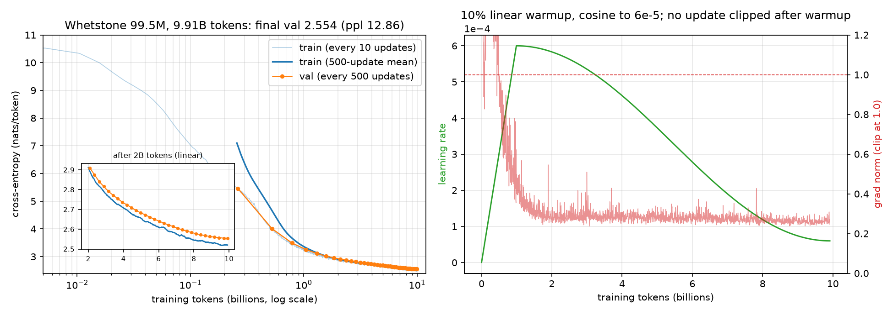

# Experiments (fill on your GPU)

This template is for **local GPU runs** with real data. The cloud/CPU smoke on `tests/fixtures/*` only proves the pipeline runs.

## Setup

- GPU, CUDA PyTorch matching your driver
- Data paths (example):
  - `datasets/pretrain.jsonl`
  - `datasets/sft.jsonl`
  - `datasets/preference.jsonl`

## Suggested protocol

| Stage | Key hparams | Checkpoint | Metrics to record |
|-------|-------------|------------|-------------------|
| Pretrain | lr, seq, steps | `pretrain_final.pth` | train loss, eval PPL |
| SFT | lr, epochs | `sft_final.pth` | loss, qualitative chat |
| KD | α, T | `distill_final.pth` | CE, KD term, PPL vs SFT |
| DPO | β | `dpo_final.pth` | DPO loss, win-rate vs SFT (manual or judge) |
| GRPO | G, β_KL, clip, aggregation | `grpo_final.pth` | eval accuracy, format rate, hack rate, silent-group fraction, entropy, completion length |

## Results (owner fills)

### Pretrain: the formal run (2026-10-11, one H800 PCIe)

| | |
|---|---|
| Model | 99.5M parameters: `--dim 768 --n_layers 12 --n_heads 12 --n_kv_heads 3`, SwiGLU 2048, RoPE θ 1e6, tied embeddings, vocab 32,768 (`tokenizer/v1_32k`) |
| Data | `configs/mixture_v2.json`: zh_web 20%, en_web 32%, code 22.9%, math 16%, books 5.7%, synthetic textbooks 3.4%; 9.914B training tokens, one epoch, 2048-token windows |
| Optimization | 18,919 updates of 32 × 8 × 2047 ≈ 524K tokens; AdamW β (0.9, 0.95), weight decay 0.1 on matrices only, clip 1.0; LR 6e-4, 10% linear warmup, cosine to 6e-5; bf16 autocast, `--compile`, `--attention_backend cudnn`, seed 1337 |
| Run | commit e223385, 14:15:49 → 22:33:47, **8.29 h, one attempt** (no crash, no resume). 336.4K tokens/s median between logs (MFU 31.6% of the 756 TFLOPS dense bf16 peak), 331.9K over the whole run: compile, a validation and a checkpoint every 500 updates cost 6.5 minutes in all |



Drawn from `records/pretrain_v2/runs/pretrain_20261011-141555_c21027/metrics.jsonl`; the training loss
is logged every 10 updates, and the inset is the part after 2B tokens on a linear scale. AutoDL's panel
sampled the GPU every 5 seconds through the run (`records/autodl_h800/gpu_monitor.csv`): utilization
median 100% (5th percentile 99%), memory flat at 45,285 MiB. That is the caching allocator's reserve,
not the working set, and 100% utilization means a kernel was always running, not that compute was
saturated; `docs/status.md` §3.3 has both.

**Loss.** Final validation loss **2.5539 (ppl 12.86)** over 3.28M tokens (the first 50 batches of the
fixed validation permutation); the mean training loss of the last 500 updates is 2.5197. Validation
loss fell at every one of the 38 evaluations:

| Tokens | 0.26B | 0.52B | 1.05B | 2.10B | 4.19B | 6.29B | 8.38B | 9.91B |
|---|---:|---:|---:|---:|---:|---:|---:|---:|
| Val loss | 5.465 | 4.009 | 3.254 | 2.909 | 2.724 | 2.631 | 2.572 | 2.554 |

- No spike: after warmup the pre-clip grad norm has median 0.276 and maximum 0.568 (update 2,170,
  just past the LR peak), and no update after warmup was clipped.
- Validation sits a constant ~0.03 above the 500-update training mean from 2B tokens to the end. With
  one epoch every training batch is unseen when its loss is measured, so this is a difference between
  the two samples, not overfitting; it never widened.

**Probes** (`probes.py` on `mixture_v2/holdout.jsonl`, at most 500K tokens per source, fp32, 116 s on
the H800). Bits per byte is comparable across vocabularies; the last column is the data ablation's
proxy (25.7M non-embedding parameters, 0.3B tokens, 512-token windows) interpolated to 20% Chinese.
Different holdout documents and window lengths make that column a rough reference only; the compute
ratio between the two is about 100×.

| Source | Docs | Bits per byte | Ablation proxy | Change |
|---|---:|---:|---:|---:|
| zh_web | 548 | 1.297 | ~1.64 | −21% |
| en_web | 393 | 1.006 | ~1.26 | −20% |
| code | 375 | 0.593 | ~0.89 | −33% |
| math | 333 | 0.881 | ~1.20 | −26% |
| books | 4 | 1.223 | — | |
| synthetic_textbook | 639 | 0.676 | — | |

- Language confusion: 2 of 100 Chinese prompts continue in another language, 0 of 100 English
  prompts drift into Chinese.
- 4-shot addition, greedy, exact match, 100 items each: **1-digit 22%, 2-digit 2%** (every ablation
  arm: 1–9%). Two-digit arithmetic is still out of reach for the base model; that gap is what SFT on
  `envs` data and GRPO have to close, and these numbers are the baseline they start from.
- Books are 4 long documents, so their number has a wide error bar.

**Samples** (`records/pretrain_v2/samples.json`: a fixed seed per prompt, top-p 0.9, no repetition
penalty, 60 new tokens; greedy where T is 0). What a 100M base model does with each kind of prompt:

- Prose is fluent in both languages and follows the frame it is given: `人工智能的发展可以分为三个阶段：`
  (T 0.7) continues `第一阶段：大数据时代。……第二阶段：机器学习时代。……`. The facts are loose, and the
  Yangtze prompt (T 0.7) falls into a loop of `长江中下游和长江东下游交汇处` within 60 tokens.
- Arithmetic: after four worked one-digit sums, `2 + 5 =` gets `9`, and after four two-digit sums,
  `41 + 35 =` gets `56`. Both times the model copies the answer of the example right above instead of
  adding.
- Code and algebra have the shape but not the content: `is_prime` yields a column of commented-out
  `elif n == 3: return False` lines, and `Solve for x: 2x + 3 = 11` gets `x = 2`, repeated.

**Records and weights.** The run's records are in git under `records/pretrain_v2/` (`runs/<id>/`,
`train.log`, `probes.json`, `samples.json`, checksums) and `records/autodl_h800/` (benchmarks, trials,
the 5-second GPU monitor, the instance's environment); `records/README.md` says what each file is.
The weights are group `pretrain-v2` of the private artifact repositories: `pretrain_final.pth` (fp32
state dict, 398MB, sha256 `0e2a6524…d627`) with its `pretrain_final.config.json`, and the end-of-epoch
checkpoint with optimizer state (`epoch_1_checkpoint.pth`, 1.19GB, sha256 `28c3d8fc…8952`; its weights
equal the final weights). `docs/artifacts.md` lists every file and `scripts/fetch_artifacts.sh
pretrain-v2` puts them back into `results/pretrain_v2/`.

### Loss / PPL

| Model | Eval PPL | Notes |
|-------|----------|-------|
| Pretrain | 12.86 | 99.5M, 9.91B tokens of `mixture_v2`, val split; see the section above |
| SFT | | |
| KD | | |
| DPO | | |

### Qualitative examples

| Prompt | SFT | KD | DPO |
|--------|-----|----|-----|
| | | | |

### Ablations (optional)

- GQA on/off (`n_kv_heads`)
- KD α ∈ {0.3, 0.5, 0.7}, T ∈ {1, 2, 4}
- DPO β ∈ {0.05, 0.1, 0.5}

## Commands (GPU example)

```bash
python pretrain.py --data_path datasets/pretrain.jsonl --device cuda:0 --dtype bfloat16 ...
python sft.py --pretrained_path results/pretrain_final.pth --device cuda:0 --dtype bfloat16 ...
python distill.py --teacher_path results/sft_final.pth --student_path results/sft_final.pth --device cuda:0 ...
python dpo.py --policy_path results/sft_final.pth --device cuda:0 ...
python grpo.py --policy_path results/sft_final.pth --device cuda:0 --dtype bfloat16 ...
```

Note: GradScaler is enabled only for `float16`; prefer `bfloat16` on modern GPUs without a scaler.

---

# Mini-RLVR (GRPO) experiment plan

The RL stage is where this project stops being a re-implementation exercise, so it gets its own
protocol. Everything below runs on one task family (`envs/arithmetic.py`), which is what makes the
SFT / DPO / GRPO numbers comparable.

## Setup

```bash
bash scripts/arith_data.sh datasets/arith_v1
```

It writes, from fixed seeds: `test.jsonl` (500 distinct problems, reported once at the end),
`dev.jsonl` (500 more, watched during training and used for any selection), and `sft.jsonl` (4000),
`preference.jsonl` (2000) and `grpo_prompts.jsonl` (20000) with every test and dev question
excluded. 1–2 digit addition and subtraction has only ~15k distinct problems, so sets drawn
independently overlap heavily: a 4000-row SFT set contained 55% of a 500-row eval set's questions.

`scripts/autodl/posttrain.sh` runs the grid below on one GPU: SFT once, then every GRPO variant
from that SFT checkpoint, each scored with `eval_env.py` on dev and test.

**Cold start is mandatory.** A policy that never emits `<think>/<answer>` scores 0 on every rollout,
so every group has zero reward variance and the gradient is exactly 0. Run SFT on the gold CoT data
first, and stop it *before* it saturates — a fully converged SFT policy has low entropy and produces
no reward variance either.

## Metrics

Every step appends one JSON line to `{save_dir}/grpo_metrics.jsonl`. Plot at minimum:

| Metric | What it answers |
|--------|-----------------|
| `eval_accuracy` | Is the model actually getting better at the task? |
| `format_rate` vs `accuracy` | Did it learn the shape or the arithmetic? |
| `hack_rate` | Fraction of well-formed wrong answers — the reward-hacking curve |
| `silent_group_frac` | Share of groups with no reward variance (wasted compute) |
| `grad_norm` | Whether a step carried signal at all (`loss` is ~0 by construction for `seq_mean`) |
| `entropy` | Collapse detector; watch it against `kl` when `--kl_coeff 0` |
| `completion_len` | Length drift / reward-shaping side effects |

## Ablation grid: 4 variants × 3 seeds on the 100M model (RTX 4090, 2026-10-12)

`SEEDS="1 2 3" bash scripts/autodl/start_posttrain.sh` at commit `58c7bb0`, 15:55–19:39 (3.7 h) on one
RTX 4090 24GB. One SFT run (4000 rows, 1 epoch = 125 steps, batch 32, lr 1e-4, 13 s of training) from
the pretrained base; then 12 GRPO runs from that same SFT checkpoint, 500 steps each: 32 prompts × 8
samples per step at temperature 1.0, lr 1e-5 with 10% warmup and cosine to 1e-6, `--micro_batch_size
64`, `--max_new_tokens 96`, a 500-item dev evaluation every 25 steps. Every final policy was then
scored once with `eval_env.py` (greedy) on dev and on test. Records are in `records/posttrain_v1/`,
the 13 checkpoints in the `posttrain-v1` artifact group (`docs/artifacts.md`).

| Run | Change | test acc, seeds 1 / 2 / 3 | test mean | dev mean | format | hack (test) | silent, steps 301–500 | entropy, steps 301–500 | minutes / run |
|-----|--------|------|------|------|------|------|------|------|------|
| SFT only | baseline, no RL | 0.628 | — | 0.636 | 1.000 | 0.372 | — | — | 13 s |
| DPO only | 2000 hand-corrupted pairs (`envs.generate_data --split preference`), lr 1e-6 | 0.626 (1 seed) | — | 0.634 | 0.998 | 0.372 | — | — | 2 |
| DPO only, on-policy | 2022 pairs mined from the SFT policy (`mine_pairs.py`), lr 1e-6 | 0.576 (1 seed) | — | 0.648 | 1.000 | 0.424 | — | — | 2 |
| GRPO | default (`seq_mean`, std-norm, no KL) | 0.954 / 0.944 / 0.944 | 0.947 | 0.973 | 1.000 | 0.053 | 0.90 | 0.0040 | 19.6 |
| GRPO + KL | `--kl_coeff 0.02` | 0.946 / 0.938 / 0.942 | 0.942 | 0.972 | 1.000 | 0.058 | 0.89 | 0.0033 | 19.8 |
| Dr. GRPO | `--normalize_advantage_std False --aggregation dr_grpo` | 0.948 / 0.954 / 0.962 | **0.955** | 0.969 | 1.000 | 0.045 | 0.91 | 0.0031 | 18.8 |
| DAPO-lite | `--filter_zero_variance True --clip_eps_high 0.28 --aggregation token_mean` | 0.950 / 0.954 / 0.944 | 0.949 | **0.977** | 1.000 | 0.051 | 0.92 | (0.0111, see below) | **16.3** |
| Format-only reward | `--format_weight 0.2 --accuracy off` (edit env weights) | not run | | | | | | | |
| Lenient parse | `--strict_answer False` | not run | | | | | | | |

(Format is 1.000 everywhere, so hack = 1 − accuracy. Minutes per run include start-up and the final
dev and test scoring.) Test accuracy by problem type, averaged over the three seeds:

| Greedy test accuracy | all 500 | 1d + | 2d + | 1d − | 2d − |
|---------------------|--------:|-----:|-----:|-----:|-----:|
| items | 500 | 51 | 211 | 44 | 194 |
| SFT | 0.628 | 0.608 | 0.763 | 0.455 | 0.526 |
| GRPO | 0.947 | 0.895 | 0.987 | 0.697 | 0.974 |
| GRPO + KL | 0.942 | 0.850 | 0.983 | 0.705 | 0.976 |
| Dr. GRPO | 0.955 | 0.869 | 0.991 | 0.780 | 0.978 |
| DAPO-lite | 0.949 | 0.902 | 0.984 | 0.712 | 0.978 |
| all 12 runs | 0.948 | 0.879 | 0.986 | 0.723 | 0.976 |

Dev accuracy during training, averaged over the three seeds:

| step | 0 | 50 | 100 | 150 | 200 | 300 | 400 | 500 |
|------|---|----|-----|-----|-----|-----|-----|-----|
| GRPO | 0.636 | 0.686 | 0.790 | 0.855 | 0.908 | 0.940 | 0.961 | 0.973 |
| GRPO + KL | 0.636 | 0.679 | 0.795 | 0.864 | 0.909 | 0.944 | 0.957 | 0.972 |
| Dr. GRPO | 0.636 | 0.699 | 0.780 | 0.863 | 0.905 | 0.945 | 0.957 | 0.969 |
| DAPO-lite | 0.636 | 0.683 | 0.787 | 0.865 | 0.910 | 0.951 | 0.967 | 0.977 |

The questions this grid was meant to answer, in rough order of how interesting the answer is:

1. **Does accuracy move at all, or does the policy only climb the format reward?** It moves: test
   accuracy goes from 0.628 to 0.938–0.962 in all 12 runs, while format was already 1.000 after SFT
   and stays there, and the mean completion stays at 36 tokens on dev (32 on test, which holds more
   one-digit problems with shorter answers), as after SFT. Two-digit problems are nearly solved
   (2d + 0.986, 2d − 0.976 over all runs). This is what the 29M runs below never managed.
2. **How large is `silent_group_frac`, and does dropping those groups buy throughput?** It rises
   from 0.37 in the first 50 steps to 0.90–0.92 over the last 200 in every variant: by then nine
   groups in ten are all correct and carry no gradient. DAPO-lite skips them in the training forward
   and backward, so its steps get cheaper as training goes on (1.92 → 1.71 s, against 2.05–2.26 s for
   the others): 16.3 minutes a run instead of 18.8–19.8, at no cost in accuracy. Over the last 200
   steps it trained on 2.4–2.7 of the 32 groups a step, and in 11–16 steps of each run, all after
   step 240, no group was left and no update was made. A harder prompt mix
   (three digits, or prompts chosen by the policy's own solve rate) would turn that idle 90% into signal.
3. **Does the std divisor matter (GRPO vs Dr. GRPO)?** Not measurably, and neither does any other
   difference between the four variants. Their test means span 0.942–0.955, the seed standard
   deviation within a variant is 0.4–0.7 points, and one 500-item score near 0.95 has a binomial
   standard error of about 1 point. Dev and test rank the variants differently (dev: DAPO-lite >
   GRPO > GRPO + KL > Dr. GRPO; test: Dr. GRPO > DAPO-lite > GRPO > GRPO + KL), and the widest pair
   on test (Dr. GRPO against GRPO + KL) gives Welch's t ≈ 2.7 on about 3 degrees of freedom, p ≈ 0.07
   before correcting for six comparisons. Selecting on dev, as the protocol says, picks `dapo_lite_s1`
   (dev 0.982), which scores 0.950 on test. Three properties of this setup explain why nothing separates:
   - **Clipping never fires.** `--ppo_epochs 1` makes each rollout batch one update, and the old
     log-probs are recomputed from the same weights just before it, so the importance ratio is
     exactly 1 and `clip_frac` was 0.000 at every step of every run. DAPO's clip-higher
     (`--clip_eps_high 0.28`) is a no-op here; it only matters with `--ppo_epochs > 1` or stale rollouts.
   - **Completion length barely varies** (the SFT template fixes it near 36 tokens), so the
     per-sequence length normalization that Dr. GRPO removes and DAPO's token-level average weight
     the sequences almost identically. Their motivation, length bias, has nothing to act on.
   - **What remains is gradient scale, which AdamW absorbs.** Pre-clip gradient norms over steps
     301–500: GRPO 0.35; Dr. GRPO 0.05, about 7× smaller (no std divisor, and a constant 96-token
     denominator instead of the ~36-token sequence length); DAPO-lite 4.3, about 12× larger (silent
     groups leave its denominator, and 1 / (1 − 0.92) ≈ 12), so `--grad_clip 1.0` clips every late
     step. Adam divides by the running RMS of the gradient, so a constant rescaling leaves the update
     nearly unchanged, and the four dev curves above coincide.
4. **Without a KL anchor, does entropy collapse before accuracy improves?** No. Per-token entropy of
   the sampled completions falls from 0.028 to 0.003–0.004 with or without KL, while accuracy climbs
   the whole way and nothing degenerates. The 0.02 KL term holds the policy at KL ≈ 0.019 from the
   SFT model and costs half a point of test accuracy, which is within noise. Unlike the 29M runs
   below, where zero reward was an absorbing state, this SFT policy starts at 63% accuracy with
   mixed groups, so there is no collapse for the anchor to prevent.
   **DAPO-lite's entropy is not comparable**: its filter runs before the training forward, so its
   entropy is averaged over the non-silent groups only, the prompts the policy is still unsure
   about (a step with no group left logs 0). It is higher from the first 50 steps (0.034 against
   0.028), when only 37% of groups are filtered. Comparing entropy across variants needs it logged
   over the whole batch, before filtering.
5. **Does `--strict_answer False` reveal correct answers hidden behind format failures?** Not run:
   with format at 1.000 from the SFT start, there are no format failures to look behind.

**One-digit problems test generalization, not the easy cases.** There are only 100 one-digit sums
and 55 one-digit differences with a non-negative result, and dev and test, drawn from the env's
distribution, take most of them: test holds 51 + 44 and dev 30 + 9. What is left for training is 19
distinct one-digit sums and **2** one-digit differences in the GRPO prompt pool, and 21 one-digit
questions in the SFT set. Accordingly they are the weakest groups after RL (1d + 0.879, 1d − 0.723
over all 12 runs, against at least 0.976 for two digits) and the most seed-dependent (1d − ranges
0.636–0.864 over its 44 items): the policies learned two-digit arithmetic and carry it over to one
digit imperfectly. A next data build should cap the held-out share of each stratum, or report the
one-digit groups as a separate generalization number.

**Reproducibility and the trial.** On CUDA the SFT run is deterministic: the trial and the formal run
(same command and seed) ended at the same loss (0.0237) with the same dev / test scores (0.636 /
0.628), unlike MPS. In the trial, 20 GRPO steps took dev from 0.636 to 0.588; that run's cosine
schedule was computed over 20 steps, so it reached the full learning rate at step 2. A diagnostic
with the Mac smoke's settings (100 steps, `--max_new_tokens 64`, micro-batch 32) rose to 0.764, and
every formal run, warmed up over 50 steps, was already above the SFT score at its first evaluation
(0.658–0.682 at step 25). On the 4090 a GRPO step took 2.1–2.3 s (DAPO-lite 1.7–1.9) and the
median GPU utilization was 52%: decoding a 100M model is bound by kernel-launch overhead, not by
the GPU. The memory PyTorch's caching allocator reserved levelled off within each run's first three
minutes, at 15.2–22.9 GiB of the 24 GiB depending on the run, and no run ran out.
`records/posttrain_v1/summarize.py` recomputes these and every other number in this section from
the committed records.

**DPO alone does not move accuracy, and the reason is in the pairs.** Two offline DPO runs from the
SFT policy (one epoch, batch 16, beta 0.1, one seed each; `records/posttrain_v2/`), scored like the
GRPO runs, with the setting chosen on dev and test read once:

| Pairs | lr | dev | test | what happened |
|-------|----|-----|------|---------------|
| hand-corrupted | 1e-5 | 0.000 | 0.002 | the loss reaches 0 by step 60 and the policy stops closing its tags: it emits `<answer151>151</answer1EDIT>…` until the token limit (88.6 tokens on average) |
| hand-corrupted | 1e-5, stopped at 20 / 40 updates | 0.610 / 0.518 | not read | the 40-update policy writes 60 tokens instead of 36 |
| hand-corrupted | 1e-6 | 0.634 | 0.626 | indistinguishable from SFT (0.636 / 0.628) |
| on-policy | 5e-6 | 0.546 | not read | worse than SFT |
| on-policy | 1e-6 | **0.648** | **0.576** | dev is within a standard error of SFT (about 2 points), test is 5 points under it |

The hand-corrupted pairs (the gold completion against an off-by-one or off-by-ten answer, a
missing-tag answer, or an empty `<think>`) are ranked correctly by the SFT policy itself: on 500
held-out pairs the chosen completion has the higher sequence log-probability in 100% of them, by 51
nats on average, so there is no ordering left for DPO to teach and it only widens a margin that was
already decisive (to 92 nats at lr 1e-6, 193 at lr 1e-5, where it also destroys the format). The
on-policy pairs put what the policy actually gets wrong on the rejected side: sampling the SFT policy
8 times on 3000 prompts, 58% of the samples are correct, 67% of the prompts have both outcomes, and one
pair per such prompt gives 2022 pairs, all of them wrong arithmetic in the right format. Here the SFT
policy ranks only 82% of 548 held-out on-policy pairs correctly. The 1e-6 model reaches 85%, the 5e-6
model's DPO accuracy (the margin against the SFT reference) rises to 73%, and neither moves greedy
accuracy: ranking two sampled completions of one prompt is a smaller thing than producing the right
one first. DPO's offline signal is also a single pass over pairs drawn from the SFT policy, while GRPO
resamples from the current policy every step and was 0.948 on the same test set. Two caveats: one seed
per setting, so the 1–2 point differences among the lr 1e-6 runs and SFT are not resolved; and dev
and test disagree on the on-policy run (+1.2 against −5.2 points), which is what selecting on a
500-item dev set costs.

## Mac smoke on the 100M model (dev set only)

The pretrained 100M base (`results/pretrain_v2/pretrain_final.pth`), on an M5 Pro (MPS, bf16), with
the data from `scripts/arith_data.sh`. The test set was not touched; these are dev numbers from one
run each, a check that the GPU grid is worth running, not its result.

```bash
python3 sft.py --pretrained_path results/pretrain_v2/pretrain_final.pth --tokenizer_path tokenizer/v1_32k \
  --data_path datasets/arith_v1/sft.jsonl --max_seq_len 128 --epochs 1 --batch_size 32 \
  --learning_rate 1e-4 --dtype bfloat16 --save_dir <sft>
python3 grpo.py --policy_path <sft>/sft_final.pth --tokenizer_path tokenizer/v1_32k \
  --data_path datasets/arith_v1/grpo_prompts.jsonl --eval_path datasets/arith_v1/dev.jsonl \
  --eval_size 500 --eval_every 25 --rl_steps 100 --batch_size 32 --group_size 8 \
  --micro_batch_size 32 --max_new_tokens 64 --max_seq_len 192 --learning_rate 1e-5 \
  --dtype bfloat16 --save_step 0 --save_dir <grpo>
```

| Greedy dev accuracy | all 500 | 1d + | 2d + | 1d − | 2d − |
|---------------------|--------:|-----:|-----:|-----:|-----:|
| items | 500 | 30 | 240 | 9 | 221 |
| SFT, 1 epoch (65 s) | 0.618 | 0.700 | 0.758 | 0.222 | 0.471 |
| + GRPO, 100 steps (15 min) | **0.778** | 0.800 | 0.912 | 0.333 | 0.647 |

(1d / 2d is the larger operand's digit count.) Format stayed 1.000 and the mean completion stayed
at 36 tokens, with nothing truncated: **the gain is accuracy, not format**, which the 29M runs
below never got. Dev accuracy at steps 0 / 25 / 50 / 75 / 100 was 0.618 / 0.692 / 0.690 / 0.746 /
0.778, still rising when the cosine schedule ended. 73% of the SFT policy's 8-sample groups were
mixed, `silent_group_frac` stayed at 0.38–0.46 per 25-step window, and entropy fell from 0.027 to
0.020. A second SFT run with the same seed and data scored 0.650: MPS training is not bitwise
reproducible, so variants are compared from one SFT checkpoint and over several seeds. The run
records are in `records/posttrain_mac_smoke/` (`sft_e1`, `grpo_probe_lr1e5`, plus the short timing runs).

## Recorded CPU runs (implementation validation, **not** a quality claim)

Three runs on the CPU dev box. They exist to show the loop runs end to end and that the
diagnostics behave the way the algorithm predicts. A 29M model trained on a few hundred samples
cannot do arithmetic, so none of these numbers say anything about capability.

Reproduce with:

```bash
python3 -m envs.generate_data --split sft  --n 300 --out datasets/arith1_sft.jsonl  --seed 0   --max_digits 1
python3 -m envs.generate_data --split eval --n 40  --out datasets/arith1_eval.jsonl --seed 777 --max_digits 1

# strong cold start (run A) / weak cold start (runs B, C)
python3 sft.py --data_path datasets/arith1_sft.jsonl --epochs 4 --batch_size 16 --learning_rate 5e-4 \
  --max_seq_len 128 --save_dir results_1d   --device cpu --dtype float32
python3 sft.py --data_path datasets/arith1_sft.jsonl --epochs 1 --batch_size 16 --learning_rate 3e-4 \
  --max_seq_len 128 --save_dir results_weak --device cpu --dtype float32

python3 grpo.py --policy_path <sft_final.pth> --env_max_digits 1 --rl_steps 150 \
  --group_size 8 --batch_size 4 --max_new_tokens 48 --max_seq_len 160 --micro_batch_size 8 \
  --eval_path datasets/arith1_eval.jsonl --eval_size 24 --eval_every 25 \
  --device cpu --dtype float32 --save_dir <out>   # + the per-run flags below

python3 analyze_grpo.py results_weak/grpo_metrics.jsonl results_weak_kl/grpo_metrics.jsonl --window 25
```

| Run | Cold start | lr | KL | Throughput |
|-----|-----------|-----|-----|-----------|
| A | 4-epoch SFT (loss ≈ 0.37) | 1e-5 | 0 | ≈ 1.8 s/step |
| B | 1-epoch SFT (loss ≈ 2.1) | 5e-5 | 0 | ≈ 1.9 s/step |
| C | 1-epoch SFT (loss ≈ 2.1) | 5e-5 | 0.02 | ≈ 2.7 s/step (extra ref forward) |

### Run A — too small a step to change behavior

Over 100 steps the greedy eval never moved (`acc` 0.208, `format` 1.000, identical completion
length every time), but the weights did change: mean |Δ| ≈ 1e-4 against a weight scale of ≈ 0.022.
At lr 1e-5 with roughly 40% of groups silent, the update is real but far too small to flip an
argmax. **A flat eval curve is not by itself evidence that the optimizer is broken** — check the
weight delta and `grad_norm` before debugging the algorithm.

### Runs B vs C — the KL anchor is what keeps the run alive

Sampled (temperature 1.0) format rate, averaged over 25-step windows:

| steps | B (no KL) | C (KL 0.02) |
|-------|-----------|-------------|
| 0–24 | 0.161 | 0.255 |
| 25–49 | **0.296** (peak) | 0.475 |
| 50–74 | 0.000 | 0.637 |
| 75–99 | 0.000 | 0.845 |
| 100–124 | 0.000 | 0.885 |
| 125–149 | 0.000 | **0.915** |

Run B collapsed at around step 50 and **never recovered**: reward went to 0 everywhere, so every
group had zero variance, so the advantage was zero, so `grad_norm` was exactly 0 for the remaining
100 steps. Its entropy had fallen from 3.75 to ≈ 1.3 and the policy degenerated into repeating a
single token:

```text
<think><think><think><think><think><gan</think><think>< conclusion</think><answer><think
```

Run C, same learning rate and seed with only `--kl_coeff 0.02` added, held entropy near 2.0 and
climbed monotonically. This is the clearest single result in the repo: **zero reward is an
absorbing state for GRPO**, and the KL term's job here is not gentle regularization, it is
preventing the run from dying.

### What both runs actually learned: the format, and only the format

Accuracy stayed at **0.000 for all 150 steps in every run**, while `hack_rate` tracked
`format_rate` exactly — i.e. every single well-formed completion had a wrong answer. Run C's
greedy eval format rate reached 1.000 by step 150 with these completions:

```text
<think>右</think><answer>理论 government才能ogle</think><answer> exercis store</answer>...
```

The policy maximized the only reward component it could reach. This is the reason the env reports
`accuracy` and `format` separately and derives `hacked_format` from them: a single scalar reward
curve would have looked like steady progress.

Note also that `silent_group_frac` traces a **U shape** in run C: 0.25 early (nothing works, no
variance), 0.02 in the middle (real learning signal), then back to 0.47 at the end — once the format
reward saturates, every rollout scores the same 0.2 again and the gradient dies a second time. At
this model scale the only way out is for the accuracy component to start producing variance, which
29M parameters trained on 300 samples never manage.

### Follow-ups worth running on a GPU

1. A cold start strong enough that accuracy has nonzero variance (bigger model or far more SFT data)
   — without it, GRPO can only optimize format. Done with the 100M model: see the Mac smoke above.
2. `--filter_zero_variance True` on run C: the U shape says roughly half the late-run compute is
   producing exactly zero gradient. Done on the 100M model as part of DAPO-lite: late in training 90%
   of groups are silent, and skipping them cut a run's wall clock by 17% at the same accuracy (grid above).
3. An entropy floor or `--clip_eps_high` (DAPO clip-higher) as an alternative to the KL anchor, to
   test whether the collapse in run B is specifically a KL problem or a general exploration problem.
   Clip-higher needs `--ppo_epochs > 1` to do anything: with one update per rollout batch the ratio is
   exactly 1 and nothing is ever clipped (`clip_frac` was 0 in all 12 runs of the grid).
